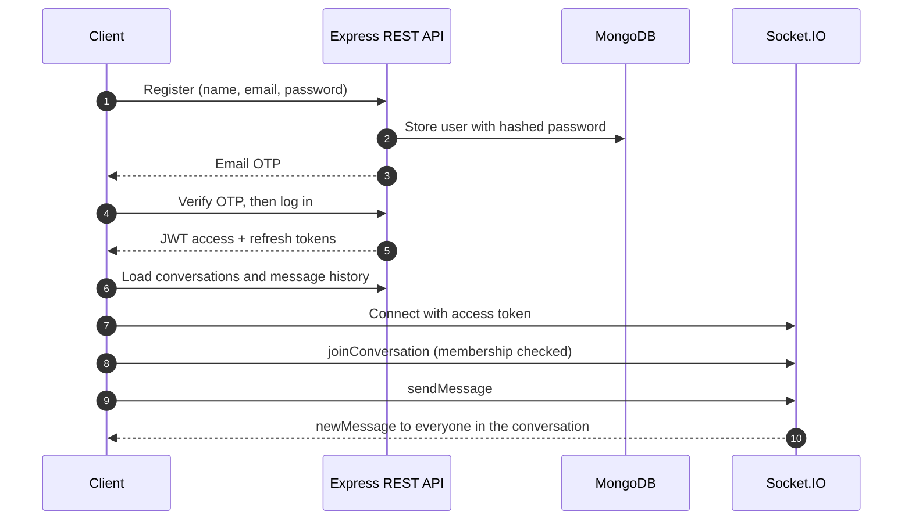

<!--
  PROFILE README for github.com/harshcans

  SETUP
  1. Create a PUBLIC repository named exactly: harshcans   (github.com/harshcans/harshcans)
  2. Add this file as README.md and commit it to the main branch.
  3. Search this file for "EDIT" and replace those few values, then delete this comment block.

  The animated banner (capsule-render) and typing line (readme-typing-svg) are free
  third-party services. If either is ever down, the alt text is shown instead.
-->

<!-- Animated header: waving gradient banner with fade-in name -->

<!-- Typing animation: rotates through three lines, adapts to light and dark mode -->
<picture>
  <source media="(prefers-color-scheme: dark)" srcset="https://readme-typing-svg.demolab.com?font=Fira+Code&weight=500&size=18&duration=3200&pause=1100&color=60A5FA&center=true&vCenter=true&width=640&height=44&lines=React+%C2%B7+Next.js+%C2%B7+Node.js+%C2%B7+MongoDB;Secure+auth+%C2%B7+Real-time+apps+%C2%B7+Clean+APIs;Building+and+shipping+to+production">
  <source media="(prefers-color-scheme: light)" srcset="https://readme-typing-svg.demolab.com?font=Fira+Code&weight=500&size=18&duration=3200&pause=1100&color=2563EB&center=true&vCenter=true&width=640&height=44&lines=React+%C2%B7+Next.js+%C2%B7+Node.js+%C2%B7+MongoDB;Secure+auth+%C2%B7+Real-time+apps+%C2%B7+Clean+APIs;Building+and+shipping+to+production">
  
</picture>

 

 <!-- EDIT: your LinkedIn URL -->
 <!-- EDIT: your email -->

 

## About

I'm a full-stack developer based in India. My projects cover the whole path from UI to database to deployment: a Stripe-powered storefront, a real-time chat system with OTP-verified accounts, a document app with in-browser OCR, and a REST API with validation and business rules.

I care about **secure auth, validated input, documented APIs and responsive UI**, and I deploy what I build so people can try it.

- **Open to:** full-time and internship roles in full-stack development <!-- EDIT: change if different -->
- **Currently:** learning TypeScript and adding automated tests to my Node.js projects <!-- EDIT: keep only what is true -->

 

## Featured projects

<table>
<tr>
<td valign="top" width="50%">

#### [Real-Time Chat Application](https://github.com/harshcans/chat-application)

Secure messaging with verified accounts and live message delivery.

- Email OTP verification and JWT access + refresh tokens
- Socket.IO delivery with stored message history
- Membership checks on both REST and socket handlers
- Postman collection covering the full flow

`Node.js` `Express` `MongoDB` `Socket.IO` `JWT`

[Source code](https://github.com/harshcans/chat-application)

</td>
<td valign="top" width="50%">

#### [Educans](https://github.com/harshcans/educans)

Education-resources web app with in-browser PDF reading and OCR.

- PDF viewing with pdf.js
- Text extraction from images and documents with Tesseract.js
- Firebase and Supabase integrations for auth and storage
- Deployed on Vercel

`React` `pdf.js` `Tesseract.js` `Firebase` `Supabase`

[Live demo](https://educans.vercel.app/) · [Source code](https://github.com/harshcans/educans)

</td>
</tr>
<tr>
<td valign="top" width="50%">

#### [Amazon-v5](https://github.com/harshcans/Amazon-v5)

Full-stack e-commerce app built with Next.js.

- Google and Facebook sign-in
- Stripe payments at checkout
- User data stored in Firebase Firestore
- Fully responsive Tailwind UI

`Next.js` `React` `Tailwind CSS` `Firebase` `Stripe`

[Live demo](https://amazon-v5.vercel.app) · [Source code](https://github.com/harshcans/Amazon-v5)

</td>
<td valign="top" width="50%">

#### [LeetCode Progress Explorer](https://github.com/harshcans/leetcode-progress-tracker)

Dashboard to track LeetCode stats and compare with a rival.

- Difficulty breakdown, contest rating and topic-wise skill diagnostics
- Head-to-head comparison with any other handle
- Dark mode, glassmorphic UI, 7-day session via localStorage
- Fault-tolerant API fetching so the dashboard never crashes

`React` `Vite` `Tailwind CSS` `alfa-leetcode-api`

[Live demo](https://leetcode-track-progress.vercel.app) · [Source code](https://github.com/harshcans/leetcode-progress-tracker)

</td>
</tr>
<tr>
<td valign="top" width="50%">

#### [Event Management API](https://github.com/harshcans/Event-Management)

REST API for managing society events.

- Full CRUD with search, filtering, pagination and sorting
- Validation and business rules (no past events, no duplicates, completed events locked)
- Consistent error handling and HTTP status codes
- Postman collection and API documentation

`Node.js` `Express` `MongoDB` `Mongoose`

[Source code](https://github.com/harshcans/Event-Management)

</td>
<td valign="top" width="50%">

#### More work

Smaller experiments and learning projects live on my repositories page.

 

[Browse all repositories →](https://github.com/harshcans?tab=repositories)

</td>
</tr>
</table>

<b>How the chat application works</b> (architecture)

 

 

## Tech stack

<table>
<tr>
<td width="150"><b>Front end</b></td>
<td>

</td>
</tr>
<tr>
<td><b>Back end</b></td>
<td>

</td>
</tr>
<tr>
<td><b>Data and services</b></td>
<td>

</td>
</tr>
<tr>
<td><b>Tooling and deploy</b></td>
<td>

</td>
</tr>
</table>

Also used: HTML/CSS · Mongoose · bcrypt · Nodemailer · pdf.js · Tesseract.js

 

## How I build

- **Security first:** hashed passwords, OTP-verified accounts, JWT access and refresh tokens, and authorization checks on real-time channels.
- **Reliable APIs:** input validation, consistent error handling, pagination, and documented endpoints with Postman collections.
- **Real-time features:** Socket.IO rooms with membership checks, backed by stored history.
- **Shipped, not just coded:** live demos on Vercel with responsive layouts and dark mode.

 

## Get in touch

Happy to talk about full-stack projects, open source or opportunities.

[Portfolio](https://harshsingh.netlify.app) · [LinkedIn](https://www.linkedin.com/in/YOUR-HANDLE) · [Email](mailto:YOUR-EMAIL) <!-- EDIT: same LinkedIn URL and email as above -->

<!-- Animated footer to match the header -->

